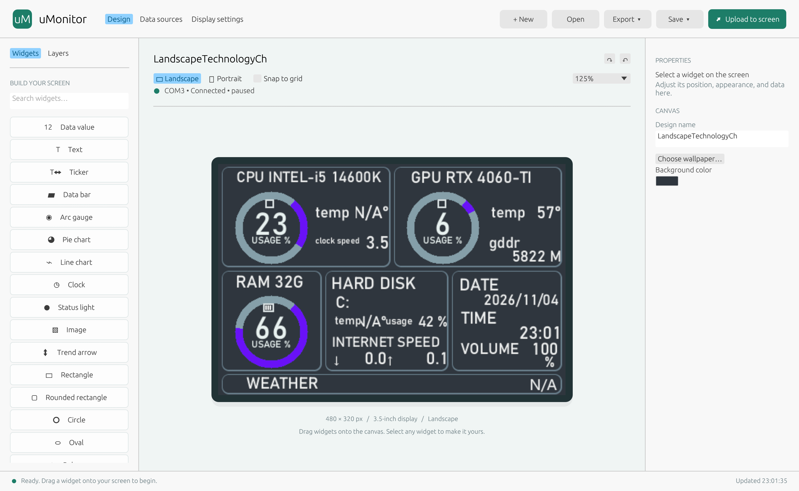
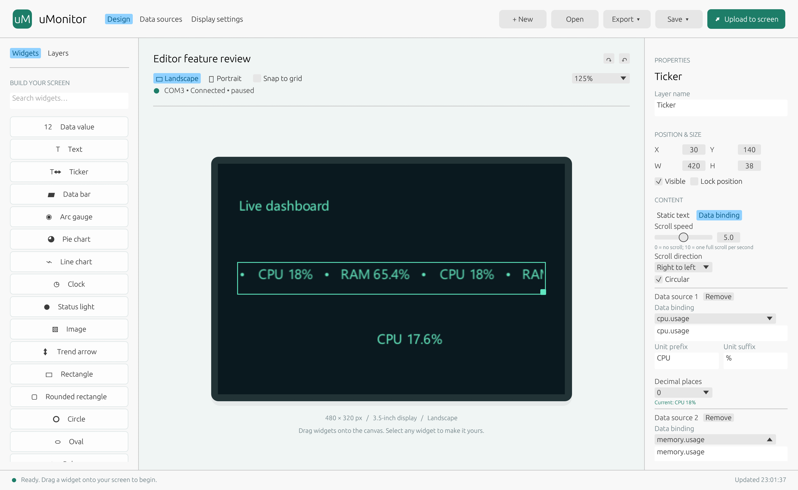
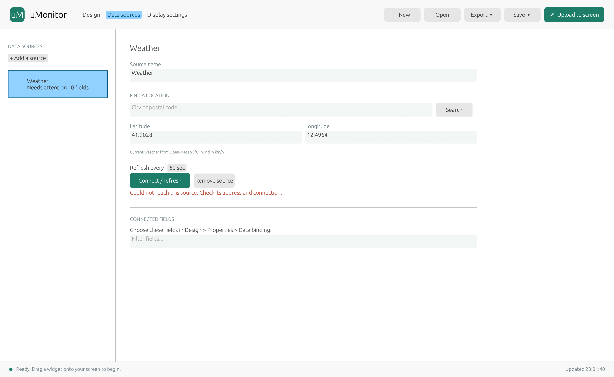
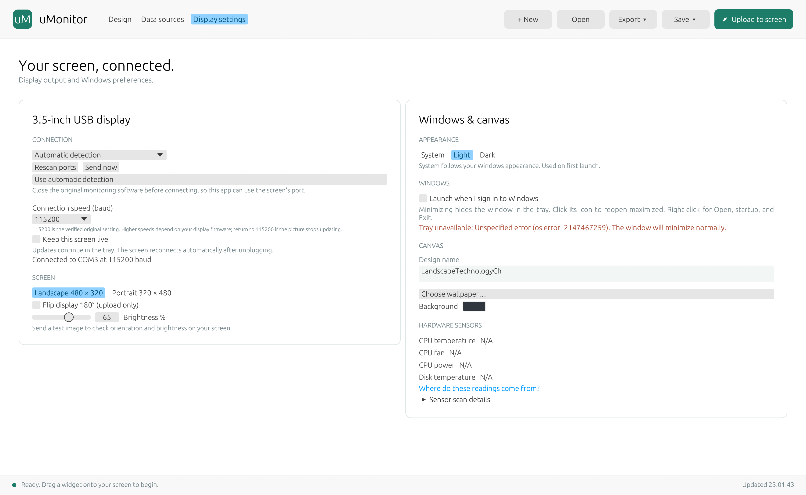

# uMonitor

**Design a live dashboard for a 480 × 320 USB display, directly on Windows.**

This project contains only **uMonitor for the original 3.5-inch USB monitor**
(480 x 320). Other display protocols are not supported.

uMonitor is a visual dashboard editor for system readings, weather, stock quotes, Home Assistant and your own HTTP/HTTPS JSON feeds. Arrange widgets on a landscape or portrait canvas, preview the result, and upload it to a compatible serial-connected display. No coding is needed to build a dashboard.



## Get started

1. Open **`dist`** and either extract **`uMonitor-0.1.0-windows-x64-portable.zip`** into a writable folder, or double-click **`uMonitor-0.1.0-windows-x64.msi`** to install for your Windows account.
2. Run **`uMonitor.exe`**, approve the Windows administrator prompt, and keep `msvcr120d.dll` beside it. Canceling the prompt closes the app.
3. Choose **New** for a starter layout, or **Open** to load an example from `config`.
4. Drag widgets onto the canvas. Select a widget to change its appearance and **Data binding** in Properties.
5. In **Display settings**, choose the display's COM port. Use **Upload to screen** for one upload or enable continuous streaming.

The portable package targets **64-bit Windows 10/11** and needs no Rust, Python, .NET or separate Visual C++ runtime installation. It includes application dependencies, example configurations, screenshots and dependency notices. Windows supplies system libraries and installed fonts; the display may need its vendor's USB serial driver. You can design layouts without connecting a display. See [the portable quick start](PORTABLE.md).

## Build a dashboard

- Use **480 × 320 landscape** or **320 × 480 portrait**, with wallpaper resized to fit.
- Add text, live values, bars, arc gauges, pie charts, line histories, clocks, status lights, images, shapes and scrolling tickers.
- Drag and resize widgets, snap to a grid, adjust colors/fonts/rotation, reorder or lock layers, duplicate objects, and undo or redo changes.
- Shift/Ctrl-click for multiple selection or drag an empty area to box select. Edit shared properties, move the selection together, or press Esc to clear it.
- Give bound fields their own unit prefix, suffix and decimal precision. Missing sensor values show `N/A`.
- Save editable **JSON**, export the screen as **PNG**, or import/export legacy **`.data`** themes.

Legacy exports contain a rendered snapshot for older software plus an editable JSON payload for uMonitor. Imported legacy artwork can be a combined bitmap rather than separately editable objects. Exact acceptance of exported snapshots by the original application has not been verified.

### Scrolling tickers

Use static text or an ordered list of live fields. Choose a direction, speed from 0 to 10, circular scrolling, and independent precision and units for each field. The canvas and display stream animate the same content.



### Connect data sources

Choose **Data sources** to configure a connection, then **Connect / refresh**. Return to **Design > Properties > Data binding** to choose fields for a widget.

| Source | Available data / setup |
| --- | --- |
| This PC | CPU, RAM, disk and network usage; clock and Windows volume. Additional temperatures, fans and power depend on available sensors. |
| HTTP / HTTPS JSON | Enter an endpoint; choose no authentication, a bearer token, or username/password. |
| Home Assistant | Enter the server address and a long-lived access token; bind returned entity states. |
| Weather | Search for a city or enter latitude/longitude for Open-Meteo weather. |
| Stocks | Enter an Alpha Vantage API key, search a symbol and choose **+ Follow**. Quotes are end-of-day by default; availability and request limits depend on your plan. |



Passwords, tokens and API keys are stored in **Windows Credential Manager**, and excluded from saved/exported JSON. Enter them again when moving to a different Windows account or PC. Source addresses remain in designs, so avoid embedding secrets in URLs.

### Use your display and hardware sensors

Display settings provides COM-port selection, flip, brightness, baud rate and streaming controls. The default serial speed is **115200 baud**. Faster selectable rates depend on firmware; physical display compatibility and maximum throughput have not been verified on every device. Only one application can use a COM port at a time.



The package includes the existing HWiNFO sensor client **`msvcr120d.dll`**. Despite the filename, it is not Microsoft's debug C runtime. The app also checks Windows sensors, NVIDIA's installed `nvidia-smi`, LibreHardwareMonitor/OpenHardwareMonitor and HWiNFO gadget values when those providers are available. These optional external programs are not needed to launch the editor. Hardware, drivers and permissions determine sensor availability; see **Hardware sensors > Sensor scan details**. A successful DLL load does not guarantee temperature/fan/power readings.

Minimize to the Windows tray to keep updates running. Click the tray icon to reopen; right-click for Open, Windows startup and Exit. Connection changes are reflected in the tray icon.

Only one uMonitor editor can run at a time in your Windows session. Launching it again shows an "already running" message and closes the extra launch, including when the editor is minimized to the tray.

## Example configurations

| File | Example |
| --- | --- |
| [`config/landscape.json`](config/landscape.json) | Detailed hardware dashboard, 480 × 320. Hardware headings are editable examples. |
| [`config/portrait.json`](config/portrait.json) | Clock, CPU/RAM gauges and network readings, 320 × 480. |
| [`config/ticker.json`](config/ticker.json) | Circular CPU/RAM/network ticker with per-field precision. |
| [`config/connected-sources.json`](config/connected-sources.json) | JSON, Home Assistant, weather and stock connection examples without credentials. |

See [config instructions](config/README.md) for setup. The first three examples use local readings without API keys; the landscape weather field needs a connected source. The screenshots above are actual app captures. Live values and available sensors vary by PC.

## Portable files and settings

```text
uMonitor/
  uMonitor.exe
  msvcr120d.dll
  config/                  editable example designs
  docs/screenshots/        captures used by this README
  licenses/                dependency inventory and license notices
  manifest.json            file sizes and SHA-256 hashes
  README.md
  PORTABLE.md
  THIRD_PARTY_NOTICES.md
```

The app creates **`cockpit-session.json` beside the executable**, retaining its previous filename for compatibility. Keep the folder writable and close the app before moving it. Images and imported custom fonts are embedded in designs; Windows fonts come from the destination PC. The Chinese starter layout needs a suitable installed font, such as Microsoft YaHei. If the folder is moved after enabling Windows startup, disable and re-enable startup from the tray menu.

## Build from source

The application source is the repository root, containing `Cargo.toml` and `build.ps1`. Install stable Rust for `x86_64-pc-windows-msvc`, Visual Studio C++ Build Tools and the Windows SDK. Keep the bundled sensor library in that source directory.

```powershell
powershell -NoProfile -File .\build.ps1
cargo test --release --locked
cargo fmt --check
.\target\release\uMonitor.exe
```

Every completed build creates the release executable and three deliverables in **`dist/`** (at the repository root, or beside `build.ps1` in an extracted source archive), each with a `.sha256` checksum:

- **`uMonitor-0.1.0-windows-x64-portable.zip`**: extract and run.
- **`uMonitor-0.1.0-windows-x64.msi`**: installs into `%LOCALAPPDATA%\Programs\uMonitor`, adds a Start menu shortcut and supports uninstall from Windows Settings. This writable location keeps existing session behavior. Uninstall preserves personal sessions.
- **`uMonitor-0.1.0-source.zip`**: complete buildable source, configuration, assets and bundled sensor library; excludes caches and personal sessions.

Building the packages also requires Python 3.11 or later. MSI creation uses Windows Installer and the Windows `makecab` utility, with no extra packaging software. The archive includes the entire `config/` directory: examples, instructions, nested assets and hidden files. Use `-OutputDirectory` to choose another destination and `-Offline` when dependencies are cached.

The Windows target configuration links the C runtime statically. The Rust build script embeds the application icon/version information and copies the sensor DLL beside the executable. Dependencies must be downloaded for a first build.

The packaging script can also be invoked directly from the source directory:

```powershell
powershell -NoProfile -File scripts/package-portable.ps1 -OutputDirectory .\dist
```

The script builds the release, copies distribution files, includes dependency notices, and creates a ZIP plus its `.sha256` checksum. With Python available, verify archive contents, hashes, Windows imports and every source config file using `python scripts/verify-portable.py dist/uMonitor-0.1.0-windows-x64-portable.zip`. Maintainers can regenerate the examples with `python scripts/generate_examples.py`.

For an isolated screenshot that does not read or overwrite the current session or stream to the display:

```powershell
.\target\release\uMonitor.exe --screenshot screenshot.png
```

Screenshots exit automatically after rendering. Sensor availability and physical screen output should be checked on the intended hardware. Original behavior and remaining compatibility limits are documented in `MECHANICS.md` in the source tree. Third-party notices are in [THIRD_PARTY_NOTICES.md](THIRD_PARTY_NOTICES.md).
